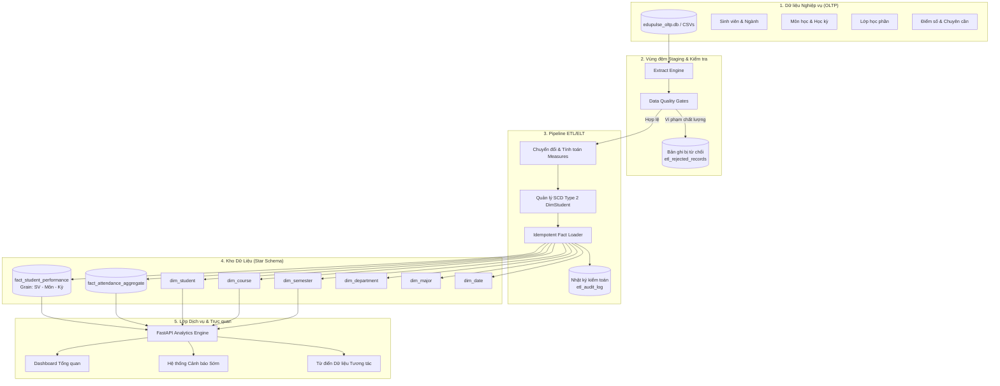

# EduPulse — Data Warehouse Architecture Document
## Student Learning Analytics & Data Warehouse

### 1. Tổng quan Kiến trúc

EduPulse được thiết kế theo phương pháp luận **Kimball Dimensional Modeling**, tối ưu hóa cho các truy vấn phân tích trực tuyến (OLAP), tạo báo cáo KPI quản lý đào tạo và hỗ trợ hệ thống cảnh báo học tập sớm (Early Warning System).

Hệ thống phân tách thành 5 tầng dữ liệu độc lập:

---

### 2. Chi tiết 5 Tầng Kiến trúc

#### Tầng 1: Nguồn Dữ liệu Nghiệp vụ (Simulated Operational OLTP)
- Mô phỏng cơ sở dữ liệu đào tạo trường đại học (`edupulse_oltp.db`) chuẩn hóa ở dạng 3NF.
- Các thực thể: `students`, `departments`, `majors`, `courses`, `semesters`, `class_sections`, `enrollments`, `attendance_logs`.
- Điểm mấu chốt: Chứa dữ liệu giao dịch phát sinh hàng ngày, có thể xuất hiện sai sót nhập liệu (điểm ngoài biên, mã môn không tồn tại, đăng ký trùng lặp).

#### Tầng 2: Vùng đệm Staging (Staging & Data Quality Gate)
- Tiếp nhận dữ liệu nguồn vào bộ nhớ tạm (DataFrames/Staging Tables) mà không làm ảnh hưởng đến hiệu năng của hệ thống OLTP.
- Thực hiện 7 tầng kiểm soát chất lượng (Quality Gates):
  1. **Mandatory Check:** Loại bỏ bản ghi thiếu các trường bắt buộc (`student_id`, `course_code`, `semester_id`).
  2. **Referential Integrity:** Kiểm tra sự tồn tại của sinh viên, môn học, học kỳ trong bảng danh mục.
  3. **Duplicate Grain Detection:** Phát hiện và loại bỏ các lượt đăng ký trùng lặp `(student_id, course_code, semester_id)`.
  4. **Score Range Validation:** Đảm bảo `0.0 <= total_score <= 10.0`.
  5. **Attendance Range Validation:** Đảm bảo `0.0 <= attendance_rate <= 100.0%`.
  6. **Rejection Logging:** Mọi bản ghi lỗi đều được chuyển vào bảng `etl_rejected_records` kèm mã nguyên nhân và payload JSON gốc để phục vụ truy vết.

#### Tầng 3: Pipeline Chuyển đổi & Nạp (ETL/ELT Engine)
- Tính toán các measure phái sinh chuẩn hóa:
  * Điểm quy đổi hệ 4 (`gpa_point_4`): 4.0, 3.5, 3.0, 2.5, 2.0, 1.5, 1.0, 0.0.
  * Xếp loại điểm chữ (`letter_grade`): A+, A, B+, B, C+, C, D+, D, F.
  * `credits_attempted`: Số tín chỉ đăng ký của môn học.
  * `credits_earned`: Bằng `credits_attempted` nếu đạt (`total_score >= 4.0`), ngược lại bằng 0.
  * `is_passed`: Cờ nhị phân (1: Đạt, 0: Trượt).
- Quản lý lịch sử thuộc tính bằng **SCD Type 2** trên chiều sinh viên (`dim_student`).
- **Idempotent Loading:** Sử dụng câu lệnh `ON CONFLICT(student_key, course_key, semester_key) DO UPDATE` giúp việc chạy lại cùng một đợt ETL không bao giờ làm nhân đôi số liệu hoặc sai lệch kho dữ liệu.
- Ghi nhật ký kiểm toán vào `etl_audit_log` (thời lượng, số dòng trích xuất, số dòng hợp lệ, số dòng bị loại).

#### Tầng 4: Kho Dữ Liệu Chiều (Kimball Star Schema Data Warehouse)
- Được triển khai trên SQLite (hoặc PostgreSQL với cùng cấu trúc DDL).
- Bảng Fact trung tâm: `fact_student_performance` liên kết chặt chẽ với các Dimension vệ tinh thông qua khóa thay thế kiểu số nguyên (Surrogate Keys).
- Đánh chỉ mục hiệu năng cao (B-Tree Indexes) trên tất cả các khóa ngoại và khóa phức hợp.

#### Tầng 5: Lớp Dịch vụ Phân tích & Giao diện Trực quan (API & Analytics Frontend)
- **Backend FastAPI:** Cung cấp các endpoint RESTful tính toán chỉ số theo thời gian thực với bộ lọc động đa chiều.
- Tuân thủ nghiêm ngặt nguyên tắc **Toán học Tổng hợp Chính xác**:
  * Không lấy trung bình cộng của các số trung bình (No Average-of-Averages).
  * GPA tín chỉ = `SUM(gpa_point_4 * credits_attempted) / SUM(credits_attempted)`.
  * Tỷ lệ đạt % = `SUM(is_passed) * 100 / COUNT(*)`.
  * Số sinh viên duy nhất = `COUNT(DISTINCT student_key)`.
- **Frontend React 18 + Vite + Tailwind CSS + Recharts:** Giao diện trực quan, hỗ trợ đầy đủ 11 trang chuyên biệt từ phân tích học vụ đến sơ đồ kiến trúc và Data Dictionary.
