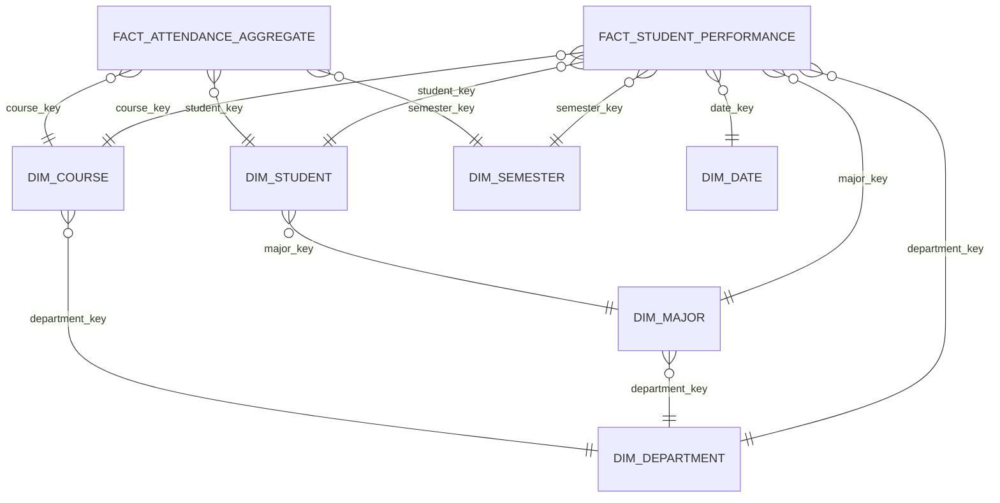

# EduPulse — Logical Schema Document
## Kimball Star Schema Design & Dimensional Modeling

### 1. Triết lý Thiết kế Mô hình Chiều

Mô hình logic của EduPulse áp dụng cấu trúc **Mô hình Sao (Star Schema)** chuẩn mực:
- **Bảng Fact ở trung tâm**: Ghi nhận các sự kiện học tập thực tế và các phép đo định lượng (Measures).
- **Các bảng Dimension bao quanh**: Cung cấp ngữ cảnh phong phú phục vụ thao tác cắt lát (Slicing), lọc (Filtering) và nhóm (Grouping) trên Dashboard.

---

### 2. Định nghĩa Độ chi tiết Hạt (Fact Grain)

> **GRAIN của Bảng Fact `fact_student_performance`:**
> **Một bản ghi đại diện cho một lượt sinh viên đăng ký tham gia một lớp học phần tại một học kỳ cụ thể.**

Khóa hạt vật lý gồm bộ ba:
`PRIMARY GRAIN = (student_key, course_key, semester_key)`

Đặc điểm phân loại Measures:
1. **Fully Additive Measures (Cộng gộp hoàn toàn):**
   - `credits_attempted`: Có thể cộng gộp theo sinh viên, học kỳ, khoa, toàn trường.
   - `credits_earned`: Tín chỉ đạt được, cộng dồn để xác định điều kiện tốt nghiệp.
   - `is_passed`: Số lượng môn đạt = `SUM(is_passed)`.
   - `is_retake`: Số lượt học lại = `SUM(is_retake)`.
2. **Semi-Additive / Non-Additive Measures (Không cộng gộp trực tiếp):**
   - `total_score`, `midterm_score`, `final_score`: Phải dùng hàm `AVG()`, tuyệt đối không dùng `SUM()`.
   - `attendance_rate`: Tỷ lệ chuyên cần trung bình = `AVG(attendance_rate)`.
   - `gpa_point_4`: Điểm thang 4, phải nhân với trọng số tín chỉ trước khi tổng hợp (`SUM(gpa_point_4 * credits) / SUM(credits)`).
3. **Degenerate Dimension (Chiều suy biến):**
   - `section_id`: Mã lớp học phần (ví dụ: `SEC_CS101_2023_HK1_01`) được lưu trữ trực tiếp trong Fact mà không cần tạo bảng chiều riêng biệt vì không có thêm nhiều thuộc tính mở rộng.

---

### 3. Phân biệt Khóa Nghiệp vụ & Khóa Thay thế

| Bảng | Khóa Nghiệp vụ (Natural Key) | Khóa Thay thế (Surrogate Key) | Lý do sử dụng Surrogate Key |
| :--- | :--- | :--- | :--- |
| `dim_student` | `student_id` (SV2022001) | `student_key` (INTEGER) | Hỗ trợ SCD Type 2 (1 mã SV có thể có nhiều phiên bản theo thời gian) |
| `dim_course` | `course_code` (CS101) | `course_key` (INTEGER) | Tối ưu hóa tốc độ JOIN bằng số nguyên, bảo vệ kho khi mã môn đổi |
| `dim_semester` | `semester_id` (2023_HK1) | `semester_key` (INTEGER) | Sắp xếp tuyến tính theo thời gian học vụ |
| `dim_department` | `department_id` (CNTT) | `department_key` (INTEGER) | Cô lập khỏi thay đổi cơ cấu tổ chức trường |
| `dim_major` | `major_id` (KTPM) | `major_key` (INTEGER) | Quản lý thay đổi chương trình đào tạo |

---

### 4. Cơ chế Quản lý Lịch sử Thuộc tính (SCD Type 2)

Trong `dim_student`, EduPulse cài đặt cơ chế **Slowly Changing Dimension Type 2 (SCD 2)**:
- `valid_from`: Thời điểm bản ghi phiên bản bắt đầu có hiệu lực.
- `valid_to`: Thời điểm bản ghi hết hiệu lực (được gán `NULL` cho phiên bản hiện hành).
- `is_current`: Cờ nhị phân (1: Bản ghi hiện hành, 0: Bản ghi lịch sử).

Khi sinh viên thay đổi chuyên ngành (ví dụ từ KHMT sang KTPM) hoặc thay đổi trạng thái đào tạo:
1. Bản ghi hiện tại được đóng lại bằng cách cập nhật `valid_to = CURRENT_TIMESTAMP` và `is_current = 0`.
2. Một bản ghi mới được tạo với `student_key` mới, gán `valid_from = CURRENT_TIMESTAMP`, `valid_to = NULL`, `is_current = 1`.
3. Nhờ đó, các môn học sinh viên đã học ở kỳ trước vẫn được liên kết chính xác với chuyên ngành cũ, không làm sai lệch số liệu lịch sử của khoa.
